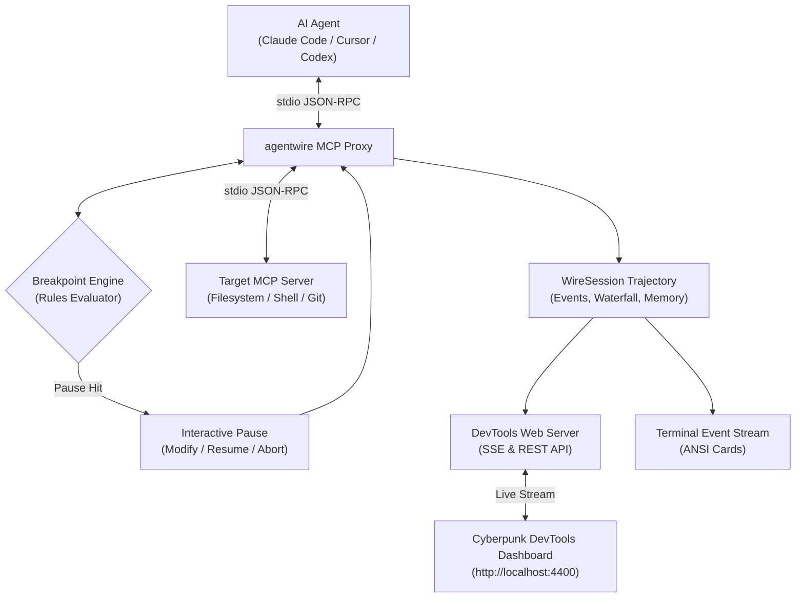

<div align="center">

```
  █████╗  ██████╗ ███████╗███╗   ██╗████████╗██╗    ██╗██╗██████╗ ███████╗
 ██╔══██╗██╔════╝ ██╔════╝████╗  ██║╚══██╔══╝██║    ██║██║██╔══██╗██╔════╝
 ███████║██║  ███╗█████╗  ██╔██╗ ██║   ██║   ██║ █╗ ██║██║██████╔╝█████╗  
 ██╔══██║██║   ██║██╔══╝  ██║╚██╗██║   ██║   ██║███╗██║██║██╔══██╗██╔══╝  
 ██║  ██║╚██████╔╝███████╗██║ ╚████║   ██║   ╚███╔███╔╝██║██║  ██║███████╗
 ╚═╝  ╚═╝ ╚═════╝ ╚══════╝╚═╝  ╚═══╝   ╚═╝    ╚══╝╚══╝ ╚═╝╚═╝  ╚═╝╚══════╝
```

### ⚡ The Wireshark & Live Time-Travel Debugger for AI Agents & MCP Workflows

[](https://www.npmjs.com/package/@shenald/agentwire)
[](LICENSE)
[](https://nodejs.org/)
[](https://modelcontextprotocol.io/)
[](.github/workflows/ci.yml)

<p align="center">
  <b>Stop debugging AI agents through walls of terminal JSON text.</b><br/>
  Wiretap MCP tool calls, set breakpoints on dangerous commands, inspect token allocation waterfalls, and time-travel replay agent trajectories in real time.
</p>

</div>

---

## ⚡ The 5-Second Problem & Solution

Autonomous AI agents (Claude Code, Cursor Composer, Aider, Antigravity, OpenHands) execute dozens of tool calls per minute. But when an agent goes into an infinite loop, hallucinates a command, or blows through context limits:

- **Without agentwire:** You are forced to read tangled, scrolling JSON-RPC logs in raw terminal windows. You cannot pause an agent before it runs `rm -rf`, and when an agent fails after 15 steps, you have to restart the entire session from zero.
- **With agentwire:** A high-speed, zero-dependency proxy sits between your agent and your tools. You get an interactive **DevTools Web UI** (`http://localhost:4400`) with visual token waterfalls, interactive breakpoints with payload editing, and time-travel trajectory branching.

```
┌──────────────────────────────────────────────────┐       ┌──────────────────────────────────────────────────┐
│             BEFORE: WITHOUT AGENTWIRE            │       │               AFTER: WITH AGENTWIRE              │
├──────────────────────────────────────────────────┤       ├──────────────────────────────────────────────────┤
│ {"jsonrpc":"2.0","method":"tools/call",...}      │       │  ⚡ agentwire DevTools (http://localhost:4400)   │
│ [Agent spewing unreadable JSON across terminal]  │  ──►  │  ├─ ⏸ BREAKPOINT HIT: bash [rm -rf /dir]        │
│ [Agent runs destructive command without pause]   │       │  │   ↳ [Approve] [Modify Args] [Abort]           │
│ [Context window exceeds 128k; session dead]      │       │  ├─ 📊 Token Waterfall: 84% eaten by tool_output │
│ [Failed at step 14; must restart from step 0]    │       │  └─ ⏪ Time-Travel: Rewind to step 12 & branch   │
└──────────────────────────────────────────────────┘       └──────────────────────────────────────────────────┘
```

---

## 🚀 Key Innovations

### 1. ⏸️ Breakpoints for AI Agents (Human-in-the-Loop Interception)
Set rules to pause the agent *before* it executes risky actions:
- Break on specific tools (e.g. `bash`, `execute_command`, `git_push`).
- Break on argument regex patterns (e.g. `/rm\s+-rf/`, `/drop\s+table/`, `/delete\s+from/`).
- Break on token thresholds (e.g. single turn payload > 4,000 tokens).
- **Edit parameters inline:** If an agent hallucinated an invalid flag or path, edit the argument directly in the Web UI and hit **Resume**!

### 2. 📊 Visual Token Waterfall & Context Inspector
Pinpoint which exact tool call, file dump, or prompt turn consumed your context window:
- Color-coded stacked bar graphs for prompt tokens, completion tokens, and tool results.
- Identify bloated tool outputs that trigger LLM context amnesia.

### 3. ⏪ Time-Travel Replay & Trajectory Forking
- Drag the **Time-Travel Scrubber** to inspect any past turn in the session.
- Click **"Branch Here"** to fork the trajectory from step `N`, inject new guidance, and test an alternative problem-solving path without starting over.

### 4. 🌐 Zero-Dependency DevTools Web Dashboard
- Single-command startup (`agentwire ui` or automatic on `agentwire mcp`).
- Cyberpunk dark-mode theme inspired by Wireshark and Chrome DevTools.
- Powered by native Node.js HTTP and real-time Server-Sent Events (SSE).

---

## ⚡ Quick Start

Execute instantly via `npx` with zero installation required:

```bash
# 1. Wiretap and proxy any MCP server command:
npx agentwire mcp npx -y @modelcontextprotocol/server-filesystem D:\my-project

# 2. Open the standalone DevTools dashboard:
npx agentwire ui --port 4400

# 3. Inspect and replay an exported session recording:
npx agentwire inspect session.agentwire.json
```

---

## 🔌 Integration with Claude Code & Cursor

Wiretap any MCP server transparently by wrapping it with `agentwire mcp`:

### Claude Desktop / Cursor Config (`mcpServers`)

```json
{
  "mcpServers": {
    "filesystem-monitored": {
      "command": "npx",
      "args": [
        "-y",
        "agentwire",
        "mcp",
        "npx",
        "-y",
        "@modelcontextprotocol/server-filesystem",
        "/path/to/workspace"
      ]
    }
  }
}
```

Now, every tool call from Claude or Cursor opens live in your `agentwire` DevTools UI at `http://localhost:4400`!

---

## 🏗️ Architecture



---

## 🛠️ CLI Reference Manual

```text
Usage: agentwire [command] [options]

Commands:
  mcp <command...>          Proxy and wiretap an MCP server over stdio
  ui                        Start the standalone DevTools Web Dashboard
  inspect <file>            Inspect and time-travel replay a recorded session file

Options:
  -p, --port <number>       Port for the DevTools Web Dashboard (default: 4400)
  --no-ui                   Disable automatic browser dashboard startup
  -e, --export <path>       Save complete session trajectory to JSON on exit
  -v, --version             Display current version
  -h, --help                Display help manual
```

---

## 🧪 Testing

`agentwire` is tested against native Node.js test runners (`node:test`) with zero external testing dependencies:

```bash
# Build TypeScript
npm run build

# Run unit and integration tests (<350ms execution)
npm test
```

---

## 📄 License

MIT © [Shenal Diluksha](https://github.com/shenald-dev) (`shenald-dev`)
