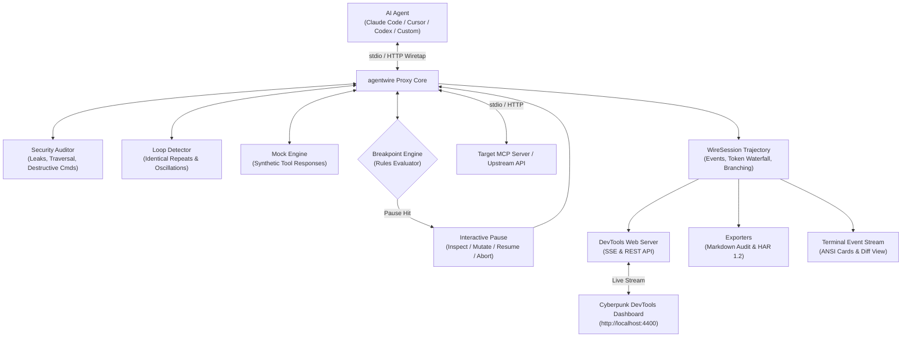

<div align="center">

```
  █████╗  ██████╗ ███████╗███╗   ██╗████████╗██╗    ██╗██╗██████╗ ███████╗
 ██╔══██╗██╔════╝ ██╔════╝████╗  ██║╚══██╔══╝██║    ██║██║██╔══██╗██╔════╝
 ███████║██║  ███╗█████╗  ██╔██╗ ██║   ██║   ██║ █╗ ██║██║██████╔╝█████╗  
 ██╔══██║██║   ██║██╔══╝  ██║╚██╗██║   ██║   ██║███╗██║██║██╔══██╗██╔══╝  
 ██║  ██║╚██████╔╝███████╗██║ ╚████║   ██║   ╚███╔███╔╝██║██║  ██║███████╗
 ╚═╝  ╚═╝ ╚═════╝ ╚══════╝╚═╝  ╚═══╝   ╚═╝    ╚══╝╚══╝ ╚═╝╚═╝  ╚═╝╚══════╝
```

### ⚡ The Wireshark & Live Time-Travel Debugger for AI Agents & MCP Workflows

[](https://www.npmjs.com/package/@shenald/agentwire)
[](LICENSE)
[](https://nodejs.org/)
[](https://modelcontextprotocol.io/)
[](.github/workflows/ci.yml)

<p align="center">
  <b>Stop debugging AI agents through walls of terminal JSON text.</b><br/>
  Wiretap MCP tool calls (stdio & HTTP), audit secret leaks in real time, break on infinite loops & destructive commands, inject virtual mocks, compare trajectory diffs, and time-travel replay agent execution.
</p>

</div>

---

## ⚡ The 5-Second Problem & Solution

Autonomous AI agents (Claude Code, Cursor Composer, Aider, Antigravity, OpenHands) execute dozens of tool calls per minute. But when an agent enters an infinite loop, leaks API keys in tool payloads, hallucinates destructive commands, or blows through context limits:

- **Without agentwire:** You are forced to read tangled, scrolling JSON-RPC logs in raw terminal windows. You cannot pause an agent before it executes `rm -rf`, you cannot detect secret exposures or looping tool calls, and when an agent fails after 15 steps, you must restart the entire session from zero.
- **With agentwire:** A high-speed, zero-dependency proxy sits between your agent and your tools. You get an interactive **DevTools Web UI** (`http://localhost:4400`), live token valuation & context exhaustion gauges, automated secret & loop detection, virtual mock injection, and side-by-side trajectory diffing.

```
┌──────────────────────────────────────────────────┐       ┌──────────────────────────────────────────────────┐
│             BEFORE: WITHOUT AGENTWIRE            │       │               AFTER: WITH AGENTWIRE              │
├──────────────────────────────────────────────────┤       ├──────────────────────────────────────────────────┤
│ {"jsonrpc":"2.0","method":"tools/call",...}      │       │  ⚡ agentwire DevTools (http://localhost:4400)   │
│ [Agent spewing unreadable JSON across terminal]  │  ──►  │  ├─ 🛡️ SECURITY AUDIT: Secret leak blocked       │
│ [Agent runs destructive command without pause]   │       │  ├─ 🔄 LOOP DETECTOR: [read_file ⇄ bash] alert   │
│ [Agent leaks OpenAI API key in curl arguments]   │       │  ├─ ⏸ BREAKPOINT HIT: bash [rm -rf /dir]        │
│ [Context window exceeds 128k; session dead]      │       │  │   ↳ [Approve] [Modify Args] [Abort]           │
│ [Failed at step 14; must restart from step 0]    │       │  ├─ 💰 Cost & Context Gauge: 64% ($0.042)        │
│                                                  │       │  └─ ⏪ Time-Travel: Rewind to step 12 & branch   │
└──────────────────────────────────────────────────┘       └──────────────────────────────────────────────────┘
```

---

## 🚀 Key Innovations

### 1. ⏸️ Breakpoints for AI Agents (Human-in-the-Loop Interception)
Set rules to pause the agent *before* it executes risky actions:
- **Tool name filters:** Break on `bash`, `execute_command`, `git_push`, etc.
- **Argument regex patterns:** Intercept dangerous patterns such as `/rm\s+-rf/`, `/DROP\s+TABLE/`, `/format\s+c:/`.
- **Token thresholds & Context budgets:** Break when a turn exceeds a specific token count or when total session consumption hits a budget percentage (e.g. 80%).
- **Inline Parameter Editing:** If an agent hallucinated an invalid flag, path, or query, modify the arguments directly in the Web UI and hit **Resume**!

### 2. 🛡️ Real-Time Security & Leak Auditor
- Continuously scans tool arguments and agent output payloads for exposed API keys and credentials (OpenAI `sk-proj-`, Anthropic `sk-ant-`, GitHub PATs, AWS access keys, private SSH keys, and bearer tokens).
- Flags directory traversal sequences (`../../`, `/etc/passwd`, sensitive system files).
- Instantly halts or alerts on destructive shell and database commands.

### 3. 🔄 Infinite Loop & Oscillation Detector
- **Identical Repeats:** Automatically detects when an agent invokes the same tool with identical parameters 3+ times in a row (e.g. repeatedly failing to read a missing file).
- **Cyclical Oscillations:** Catches period-2 flip-flop oscillations (`[toolA ⇄ toolB]`), halting runaway agent hallucination loops before your context window is exhausted.

### 4. 🎭 Virtual Tool Mocking Engine
- Inject virtual responses for specific tools without calling the actual underlying MCP server or external APIs.
- Define mock rules via `--mock-file <file.json>` or directly in the DevTools Web UI.
- Perfect for chaos testing, offline development, and simulating external API error codes.

### 5. ⚖️ Trajectory Diff Engine
- Compare two agent sessions side-by-side: `agentwire diff sessionA.json sessionB.json`.
- Pinpoints the exact step index where trajectories diverged, tool selection differences, token variance, and error emergence.

### 6. 💰 Token Valuation, Cost & Context Exhaustion Gauge
- Real-time token accounting with live financial cost calculation across Claude 3.5 Sonnet, Claude 3 Opus, GPT-4o, GPT-4o Mini, and Gemini 1.5 Pro.
- Visual context window health gauge (`healthy` <70%, `warning` 70–90%, `critical` >90%).

### 7. ⏪ Time-Travel Replay & Trajectory Forking
- Drag the **Time-Travel Scrubber** to inspect any past turn in the session.
- Click **"Branch Here"** to fork the trajectory from step `N`, inject new guidance, and test alternative problem-solving branches without restarting from scratch.

### 8. 🌐 Multi-Transport Wiretap (stdio & HTTP / SSE)
- Intercept stdio MCP server processes transparently with `agentwire mcp <command...>`.
- Intercept remote HTTP / SSE MCP servers or LLM proxy endpoints with `agentwire proxy <url>`.

---

## ⚡ Quick Start

Execute instantly via `npx` with zero installation required:

```bash
# 1. Wiretap and proxy any stdio MCP server:
npx agentwire mcp npx -y @modelcontextprotocol/server-filesystem D:\my-project

# 2. Wiretap an HTTP / SSE MCP server or remote LLM endpoint:
npx agentwire proxy http://localhost:8080/sse --port 4400

# 3. Compare two session recordings to find where the agent diverged:
npx agentwire diff session-v1.json session-v2.json

# 4. Generate a structured Markdown diagnostic audit report:
npx agentwire report session.json --output audit-report.md

# 5. Open the standalone DevTools dashboard:
npx agentwire ui --port 4400
```

---

## 🔌 Integration with Claude Code & Cursor

Wiretap any MCP server transparently by wrapping it with `agentwire mcp`:

### Claude Desktop / Cursor Config (`mcpServers`)

```json
{
  "mcpServers": {
    "filesystem-monitored": {
      "command": "npx",
      "args": [
        "-y",
        "agentwire",
        "mcp",
        "npx",
        "-y",
        "@modelcontextprotocol/server-filesystem",
        "/path/to/workspace"
      ]
    }
  }
}
```

Now, every tool call from Claude or Cursor streams live to your `agentwire` DevTools UI at `http://localhost:4400`!

---

## 🏗️ Architecture



---

## 🛠️ CLI Reference Manual

```text
Usage: agentwire [command] [options]

The Wireshark & Live Time-Travel Debugger for AI Agents & MCP Workflows

Commands:
  mcp <command...>            Proxy and wiretap an MCP server over stdio
  proxy <url>                 Proxy and wiretap remote HTTP / SSE MCP streams
  diff <fileA> <fileB>        Compare two session trajectories side-by-side
  report <file>               Generate a diagnostic Markdown audit report
  ui                          Start the standalone DevTools Web Dashboard
  inspect <file>              Inspect and time-travel replay a recorded session file

Options:
  -p, --port <number>         Port for the DevTools Web Dashboard (default: 4400)
  --no-ui                     Disable automatic browser dashboard startup
  -e, --export <path>         Save complete session trajectory to JSON on exit
  -s, --step                  Step-through mode: pause after every tool call
  -m, --model <name>          Model name for token pricing & context limits
  --mock-file <path>          Path to JSON file containing virtual mock rules
  -v, --version               Display current version
  -h, --help                  Display help manual
```

---

## 🧪 Testing

`agentwire` is tested against native Node.js test runners (`node:test`) with zero external testing dependencies:

```bash
# Build TypeScript
npm run build

# Run comprehensive test suite (29 tests across 10 suites in <400ms)
npm test
```

---

## 📄 License

MIT © [Shenal Diluksha](https://github.com/shenald-dev) (`shenald-dev`)
