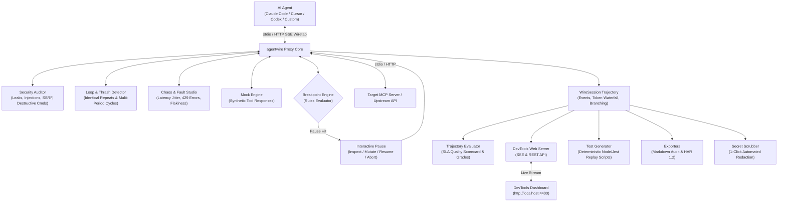

<div align="center">

```
  █████╗  ██████╗ ███████╗███╗   ██╗████████╗██╗    ██╗██╗██████╗ ███████╗
 ██╔══██╗██╔════╝ ██╔════╝████╗  ██║╚══██╔══╝██║    ██║██║██╔══██╗██╔════╝
 ███████║██║  ███╗█████╗  ██╔██╗ ██║   ██║   ██║ █╗ ██║██║██████╔╝█████╗  
 ██╔══██║██║   ██║██╔══╝  ██║╚██╗██║   ██║   ██║███╗██║██║██╔══██╗██╔══╝  
 ██║  ██║╚██████╔╝███████╗██║ ╚████║   ██║   ╚███╔███╔╝██║██║  ██║███████╗
 ╚═╝  ╚═╝ ╚═════╝ ╚══════╝╚═╝  ╚═══╝   ╚═╝    ╚══╝╚══╝ ╚═╝╚═╝  ╚═╝╚══════╝
```

### ⚡ The Wireshark & Live Time-Travel Debugger for AI Agents & MCP Workflows

[](https://www.npmjs.com/package/@shenald/agentwire)
[](LICENSE)
[](https://nodejs.org/)
[](https://modelcontextprotocol.io/)
[](.github/workflows/ci.yml)

<p align="center">
  <b>Stop debugging AI agents through walls of terminal JSON text.</b><br/>
  Wiretap MCP tool calls (stdio & HTTP), defend against prompt injection & SSRF, audit secret leaks with 1-click scrubbing, simulate chaos & rate limits, evaluate SLA trajectory quality, generate reproduction tests, and time-travel replay agent execution.
</p>

</div>

---

## ⚡ The 5-Second Problem & Solution

Autonomous AI agents (Claude Code, Cursor Composer, Aider, Antigravity, OpenHands) execute dozens of tool calls per minute. But when an agent enters an infinite loop, leaks API keys in tool payloads, falls victim to indirect prompt injection, or blows through context limits:

- **Without agentwire:** You are forced to read tangled, scrolling JSON-RPC logs in raw terminal windows. You cannot pause an agent before it executes `rm -rf`, you cannot detect indirect prompt injections or SSRF, and when an agent fails after 15 steps, you must restart from zero.
- **With agentwire:** A high-speed, zero-dependency proxy sits between your agent and your tools. You get an interactive **DevTools Web UI** (`http://localhost:4400`), live token valuation & context exhaustion gauges, automated prompt injection & secret detection with 1-click redaction, chaos latency/fault injection, SLA quality scoring, and automated regression test reproduction.

```
┌──────────────────────────────────────────────────┐       ┌──────────────────────────────────────────────────┐
│             BEFORE: WITHOUT AGENTWIRE            │       │               AFTER: WITH AGENTWIRE              │
├──────────────────────────────────────────────────┤       ├──────────────────────────────────────────────────┤
│ {"jsonrpc":"2.0","method":"tools/call",...}      │       │  ⚡ agentwire DevTools (http://localhost:4400)   │
│ [Agent spewing unreadable JSON across terminal]  │  ──►  │  ├─ 🛡️ SECURITY AUDIT: Prompt injection blocked  │
│ [Agent runs destructive command without pause]   │       │  ├─ 🔄 LOOP DETECTOR: [search ⇄ fetch] alert     │
│ [Agent leaks OpenAI API key in curl arguments]   │       │  ├─ ⏸ BREAKPOINT HIT: bash [rm -rf /dir]        │
│ [Context window exceeds 128k; session dead]      │       │  │   ↳ [Approve] [Modify Args] [Abort]           │
│ [Flaky tool crashes agent without retry testing] │       │  ├─ 🔥 CHAOS STUDIO: Injected 1500ms delay & 429 │
│ [Failed at step 14; must restart from step 0]    │       │  ├─ 📊 SLA Quality Scorecard: 94/100 (Grade: A)  │
│ [No way to reproduce failure in offline CI/CD]   │       │  └─ 🧪 Export Test: 1-Click offline test script  │
└──────────────────────────────────────────────────┘       └──────────────────────────────────────────────────┘
```

---

## 🚀 Key Innovations

### 1. ⏸️ Breakpoints for AI Agents (Human-in-the-Loop Interception)
Set rules to pause the agent *before* it executes risky actions:
- **Tool name filters:** Break on `bash`, `execute_command`, `git_push`, etc.
- **Argument regex patterns:** Intercept dangerous patterns such as `/rm\s+-rf/`, `/DROP\s+TABLE/`, `/format\s+c:/`.
- **Token thresholds & Context budgets:** Break when a turn exceeds a specific token count or when total session consumption hits a budget percentage (e.g. 80%).
- **Inline Parameter Editing:** If an agent hallucinated an invalid flag, path, or query, modify the arguments directly in the Web UI and hit **Resume**!

### 2. 🛡️ Real-Time Security, Prompt Injection & SSRF Guard
- **Indirect Prompt Injection Defense:** Catches malicious instructions embedded in tool outputs or retrieved documents (`ignore all previous instructions`, `system prompt override`, `you are now in developer mode`, markdown image exfiltration).
- **SSRF & Cloud Metadata Protection:** Detects unauthorized attempts to access AWS/GCP/Azure instance metadata endpoints (`169.254.169.254`, `metadata.google.internal`), loopback addresses (`127.0.0.1`), or private RFC 1918 subnets.
- **Secret & Credential Leak Detection:** Scans tool arguments and agent responses for exposed API keys (OpenAI `sk-proj-`, Anthropic `sk-ant-`, Google Gemini `AIza`, GitHub PATs, AWS access keys, private keys, and bearer tokens).
- **1-Click Secret Redaction (`SecretScrubber` / `--redact`):** Automatically masks sensitive credentials into safe redacted placeholders for secure trace sharing and reporting.

### 3. 🔥 Chaos & Fault Simulation Studio (`ChaosEngine`)
- **Latency Jitter Injection:** Test how your agent handles timeouts and delayed responses by injecting artificial latency (`--chaos-delay 1500`).
- **Simulated HTTP 429 & Tool Faults:** Inject rate limits or server errors (`--chaos-rate 0.25`) with custom error payloads to test agent resilience and retry backoff.
- **Transient Failure Testing (`failCount`):** Configure a tool to fail the first $N$ times and then succeed, verifying that the agent gracefully recovers.

### 4. 📊 Trajectory Quality & SLA Evaluation Engine (`agentwire eval`)
- Objectively quantifies agent execution quality on a 0–100 scale with letter grades (A+ to F).
- Computes granular scores across 4 key dimensions:
  1. **Safety & Policy Compliance**
  2. **Efficiency & Token Economy**
  3. **Reliability & Error Recovery**
  4. **Speed & Tool Latency**
- **CI/CD Quality Gates:** Enforce SLAs in pull requests using `agentwire eval session.json --threshold 80`. Fails with non-zero exit code if the trajectory falls below the threshold.

### 5. 🧪 Deterministic Reproduction Test Generator (`agentwire export-test`)
- Turn captured production or staging agent failures into offline regression tests with one command:
  `agentwire export-test session.json -o tests/reproduced-agent.test.js`
- Generates clean, zero-external-dependency test scripts using Node.js native `node:test` or `jest`.
- Pre-populates virtual mock tool responses matching the exact wire inputs and outputs, allowing deterministic replay without paying for LLM tokens.

### 6. 🔄 Advanced Multi-Period Loop & Error Thrashing Detector
- **Identical Repeats:** Catches consecutive identical tool calls (e.g. repeatedly attempting to read a missing file).
- **Multi-Period Oscillations:** Catches period-2 (`A ⇄ B`), period-3 (`A ⇄ B ⇄ C`), and period-4 cyclical agent hallucinations.
- **Error Thrashing:** Detects when an agent makes 3+ consecutive failed tool calls without adapting its strategy.

### 7. ⚖️ Trajectory Diff Engine (`agentwire diff`)
- Compare two agent sessions side-by-side: `agentwire diff sessionA.json sessionB.json`.
- Pinpoints the exact step index where trajectories diverged, tool selection differences, token variance, and error emergence.

### 8. 💰 Token Valuation, Cost & Prompt Cache Accounting
- Real-time token and financial cost accounting across **Claude 3.7 Sonnet**, Claude 3.5 Sonnet, Claude 3.5 Haiku, Claude 3 Opus, **OpenAI o1, o3-mini**, GPT-4o, GPT-4o Mini, GPT-4.5 Preview, **Gemini 2.0 Flash/Pro**, **DeepSeek-V3 / R1**, and Llama 3.3 70B.
- Accurate prompt caching discounts (up to 90% savings) and reasoning token tracking.

### 9. ⏪ Time-Travel Replay & Trajectory Forking
- Drag the **Time-Travel Scrubber** to inspect any past turn in the session.
- Click **"Branch Here"** to fork the trajectory from step `N`, inject new guidance, and test alternative problem-solving branches without restarting from scratch.

### 10. 🌐 Multi-Transport Wiretap (stdio & HTTP / SSE)
- Intercept stdio MCP server processes transparently with `agentwire mcp <command...>`.
- Intercept remote HTTP / SSE MCP servers or LLM proxy endpoints with `agentwire proxy <url>`.

---

## ⚡ Quick Start

Execute instantly via `npx` with zero installation required:

```bash
# 1. Wiretap and proxy any stdio MCP server:
npx agentwire mcp npx -y @modelcontextprotocol/server-filesystem D:\my-project

# 2. Wiretap an HTTP / SSE MCP server or remote LLM endpoint:
npx agentwire proxy http://localhost:8080/sse --port 4400

# 3. Evaluate trajectory quality and verify CI/CD SLA:
npx agentwire eval session.json --threshold 80

# 4. Generate an offline reproduction regression test from a recorded failure:
npx agentwire export-test session.json -o tests/agent-repro.test.js

# 5. Compare two session recordings to find where the agent diverged:
npx agentwire diff session-v1.json session-v2.json

# 6. Generate a redacted Markdown diagnostic audit report:
npx agentwire report session.json --redact --output audit-report.md

# 7. Open the standalone DevTools dashboard:
npx agentwire ui --port 4400
```

---

## 🔌 Integration with Claude Code & Cursor

Wiretap any MCP server transparently by wrapping it with `agentwire mcp`:

### Claude Desktop / Cursor Config (`mcpServers`)

```json
{
  "mcpServers": {
    "filesystem-monitored": {
      "command": "npx",
      "args": [
        "-y",
        "agentwire",
        "mcp",
        "npx",
        "-y",
        "@modelcontextprotocol/server-filesystem",
        "/path/to/workspace"
      ]
    }
  }
}
```

Now, every tool call from Claude or Cursor streams live to your `agentwire` DevTools UI at `http://localhost:4400`!

---

## 🏗️ Architecture



---

## 🛠️ CLI Reference Manual

```text
Usage: agentwire [command] [options]

The Wireshark & Live Time-Travel Debugger for AI Agents & MCP Workflows

Commands:
  mcp <command...>            Proxy and wiretap an MCP server over stdio
  proxy <url>                 Proxy and wiretap remote HTTP / SSE MCP streams
  diff <fileA> <fileB>        Compare two session trajectories side-by-side
  eval <file>                 Evaluate trajectory quality score (Safety, Efficiency, Reliability, Speed)
  export-test <file>          Generate a standalone offline regression test script reproducing a session
  report <file>               Generate a diagnostic Markdown or HAR audit report
  ui                          Start the standalone DevTools Web Dashboard
  inspect <file>              Inspect and time-travel replay a recorded session file

Options:
  -p, --port <number>         Port for the DevTools Web Dashboard (default: 4400)
  --no-ui                     Disable automatic browser dashboard startup
  -e, --export <path>         Save complete session trajectory to JSON on exit
  --step                      Step-through mode: pause after every tool call
  --model <name>              Target model for token pricing & context limits
  --mock-file <path>          Path to JSON file containing virtual mock rules
  --chaos-file <path>         Path to JSON file containing chaos fault simulation rules
  --chaos-delay <ms>          Inject synthetic latency into tool calls
  --chaos-rate <rate>         Inject simulated failure rate (0.0 to 1.0)
  --redact                    Sanitize and redact credentials in outputs
  --threshold <score>         Minimum passing quality score for CI/CD gates (0-100)
  --runner <node-test|jest>   Target test framework for export-test
  -v, --version               Display current version
  -h, --help                  Display help manual
```

---

## ⚡ Empirical Performance Benchmarks

Measured on a standard developer workstation under representative workloads:

| Benchmark Operation | Iterations | Total Time | Avg Latency | Throughput |
| :--- | ---: | ---: | ---: | ---: |
| `WireSession.recordEvent` (with Security & Loop scan) | 5,000 | 54.3 ms | 0.0109 ms | **92,080 ops/s** |
| `SecurityAuditor.audit` (complex payloads) | 10,000 | 24.59 ms | 0.0025 ms | **406,620 ops/s** |
| `SecretScrubber.redact` (nested object structure) | 10,000 | 58.61 ms | 0.0059 ms | **170,613 ops/s** |
| `LoopDetector.evaluate` (cycle & repetition detection) | 10,000 | 26.89 ms | 0.0027 ms | **371,916 ops/s** |
| `TrajectoryDiff.compare` (1,000 steps diff) | 200 | 50.99 ms | 0.2549 ms | **3,923 ops/s** |
| `estimateTokens` (large code string) | 5,000 | 0.71 ms | 0.0001 ms | **7,049,203 ops/s** |

To reproduce the benchmark suite locally:
```bash
npm run benchmark
```

---

## 🧪 Testing

`agentwire` is tested against native Node.js test runners (`node:test`) with zero external testing dependencies:

```bash
# Build TypeScript
npm run build

# Run comprehensive test suite (41 tests across 15 suites in ~600ms)
npm test
```

---

## 📄 License

MIT © [Shenal Diluksha](https://github.com/shenald-dev) (`shenald-dev`)
